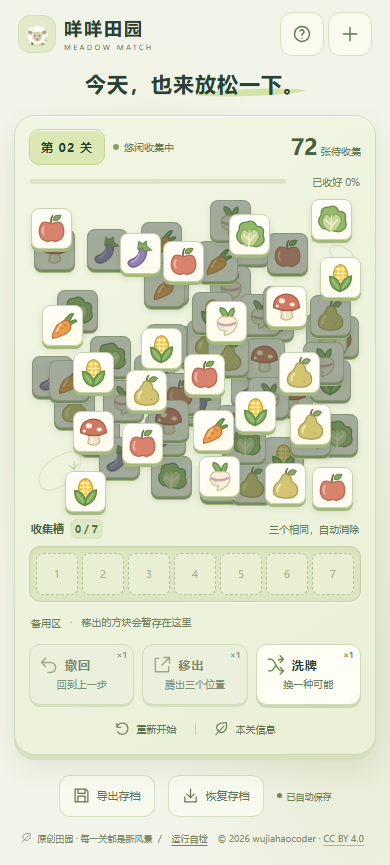
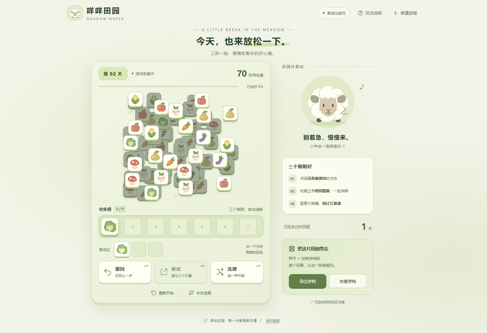

# 咩咩田园 · Meadow Match

[](https://github.com/wujiahaocoder/meadow-match/actions/workflows/ci.yml)
[](LICENSE)

**三张一组，慢慢收集你的好心情。**

一款原生 HTML、CSS、JavaScript 编写的田园三消网页游戏。挑选没有被遮挡的蔬果方块，凑齐三个，腾出七格收集槽，继续探索下一片算法生成的田园。

单文件即可离线运行，支持中途自动保存，还能用“数字种子 + 加密存档码”把当前局面带到另一台兼容设备。

[下载源码 ZIP](https://github.com/wujiahaocoder/meadow-match/archive/refs/heads/main.zip) · [快速开始](#快速开始) · [存档与恢复](#存档与恢复) · [开发与测试](#开发与测试) · [许可与修改](#许可与修改)


<details>
<summary>查看手机界面与备用区</summary>

<p></p>



</details>

## 快速开始

1. 下载上方 ZIP 并解压，或克隆本仓库。
2. 用现代浏览器打开 **`index.html`**，即可开始游戏。
3. 需要在其他设备继续时，先导出并保存两个存档代码。

**游玩无需安装 Node.js、npm 包，也无需账号或后端。** `index.html` 已内嵌样式、脚本和原创 SVG 图案，复制这个文件就能分发游戏；运行时不请求外部资源。

如果浏览器限制本地文件的存储、安全接口或 Worker，在项目目录启动本机静态服务：

```sh
python -m http.server 8080 --bind 127.0.0.1
```

然后访问 [http://127.0.0.1:8080](http://127.0.0.1:8080)。此方式只在本机提供文件，游戏逻辑和存档仍在浏览器内运行。

完整功能需要 Web Crypto、IndexedDB、Blob Worker、BigInt、`structuredClone` 和 `dialog`；恢复 gzip 压缩的存档还需要 `DecompressionStream`。缺少安全加密能力时，页面会明确提示。浏览器、文件地址和本机网址之间的自动存档可能互不相通，切换前请导出双码。

## 怎么玩

- **先看遮挡。** 只有未被更高层方块覆盖的亮色方块可以点击；移走上层后，下层会立即解锁。
- **三个一起收好。** 点击后，方块进入底部七格槽，相同图案会排列在一起；凑齐三张自动消除，其他方块重新排紧。
- **为下一张留空位。** 每一步先结算三消，再判断满槽；结算后槽内仍有七张时失败。棋盘、槽位和备用区全部清空即通关。
- **继续下一片田园。** 通关后生成新关卡；重新开始会恢复本关原始布局和道具次数。新建旅程会生成新的高熵种子，并在覆盖当前进度前要求确认。

每局有三种道具，各可使用一次：

| 道具 | 效果 |
| --- | --- |
| 撤回 | 撤销最近一次有效操作，恢复方块、槽位及局面；已消耗的道具次数不返还 |
| 移出 | 将槽内最前面的最多三张暂存到备用区，点击备用区方块可逐张收回 |
| 洗牌 | 重新分配棋盘上方块的图案，保留位置、层级和遮挡关系 |

失败后仍有撤回机会时，可以挽回最后一步。界面提供消除进度、剩余数量、槽位预警和自动保存状态，也支持鼠标、键盘聚焦操作与触屏。

## 存档与恢复

### 在本机继续

有效操作后，当前进度自动保存到 IndexedDB；刷新页面会恢复到上次保存的局面。保存失败时会在界面提示，建议及时导出双码。

### 把局面带到另一台设备

1. 点击 **导出存档**。
2. 分别复制 **游戏种子**和**加密存档码**，也可以一键复制两项或保存为文本。
3. 在兼容设备上打开本游戏，点击 **恢复存档**，粘贴两个数字串。合并复制的内容可直接粘贴到任一输入框。
4. 程序完成解密、认证与完整状态校验后显示覆盖确认，确认后恢复并写入本机存档。

恢复包含当前关卡、棋盘中途状态、槽位顺序、备用区、洗牌后的图案、道具次数、最近操作的撤回快照、通关记录与历史关卡指纹。即使清除了本地数据，仍可凭保存的两个代码恢复。

错误种子、损坏密文、不兼容版本或非法游戏状态都会被拒绝；在完整校验和覆盖确认完成前，不会替换当前进度。

### 加密机制与容量

| 环节 | 实现 |
| --- | --- |
| 种子 | `crypto.getRandomValues()` 生成 20 字节，固定最高位后保留 159 位随机熵，输出十进制数字 |
| 密钥派生 | HKDF-SHA-256，使用种子和每次新生成的 16 字节 salt |
| 认证加密 | AES-256-GCM，每次使用新的 96 位 nonce，带 128 位认证标签 |
| 压缩与编码 | 可用时先无损 gzip 压缩；二进制按带长度头的固定宽度十进制分块编码，保留前导零与字节长度 |
| 导入校验 | 检查版本、种子复现、关卡指纹、通关序列、实际遮挡、图案守恒、槽位、道具和撤回快照，再通过一个 IndexedDB 事务替换 |

种子不会嵌入存档码。数字编码只负责可复制与可逆，保密和篡改检测由 AES-GCM 提供；相同进度多次导出会得到不同密文，但恢复结果一致。

**种子相当于恢复密钥，请将两个代码作为敏感凭据保存。** 同时持有两项的人可以读取、恢复完整进度。本地 IndexedDB 自动存档以游戏状态保存，双码导出才进行上述加密；客户端加密也不等于能够防止玩家修改运行环境作弊。

存档会携带最近 **4096 条**历史指纹。历史增长时数字码会变长，导出界面显示实际长度和历史条数；不能用有限长度的代码无限存储历史。当前实现限制二进制存档包不超过 1,500,000 字节、解压后数据不超过 4,000,000 字节，超限时明确拒绝。

## 关卡如何生成

关卡来自通用的程序化算法，没有固定地图库。生成流程如下：

1. 从种子、关卡编号、生成器版本和重试参数派生独立的确定性伪随机序列。
2. 使用多中心概率场采样不规则位置，控制密度、偏移、层数和图案种类，并计算真实矩形重叠关系。
3. 构造合法的拓扑取牌顺序，再按槽位容量约束分配图案。
4. 用真实遮挡、三消与七格规则正向模拟完整序列；验证失败则重新生成。
5. 对规范化的坐标、层级、图案及完整遮挡结构计算 SHA-256 指纹，与保留历史比较；重复则更换重试参数重新生成。

生成在 Web Worker 中执行，并设置预算、重试次数和超时。每个进入游戏的初始关卡都已验证至少存在一条**不使用道具**的合法通关路径；图案数量为三的倍数不被当作可解证明。

第一关为 18 张方块的简单教学，第二关增至 72 张；后续逐渐提高图案种类、层数、图案交错和决策压力。规模最多为 **162 张、8 层、12 种图案**，避免靠无限增加方块拖慢设备。“本关信息”中可查看路径槽位峰值、初始可选数量和遮挡关系数等指标。

### 已知边界

- 可解性保证适用于初始关卡；玩家偏离可解路径或使用洗牌后，当前局面可能无解。
- 历史去重只覆盖当前保留的最近 4096 条完整结构指纹；有限设备不能承诺数学意义上的无限绝不重复。只修改方块 ID 不会改变结构指纹。
- 关卡没有预设终点，编号支持 1000、10000 及更高值；本版本使用 JavaScript 安全整数，数值上限为 **9,007,199,254,740,991**，到达后不能继续递增。
- 跨设备恢复需要兼容的存档格式、生成器版本和浏览器能力；不兼容数据会被拒绝，不会静默降级为不安全的加密方案。

## 开发与测试

开发和构建使用 **Node.js 22 或更高版本**。核心构建和单元测试仅依赖 Node.js 内置模块，无需执行 `npm install`。

```sh
git clone https://github.com/wujiahaocoder/meadow-match.git
cd meadow-match

# 修改源码后，重新生成独立 HTML
npm run build

# 运行规则、加密及存档约束测试
npm test
```

### 文件结构

```text
.
├── index.html               # 可单独分发、直接运行的游戏
├── index.template.html      # 页面、原创 SVG 图案及样式/脚本占位
├── ui.css                   # 响应式界面、弹窗和状态样式
├── app.js                   # 渲染、交互、动画、Worker 和存档入口
├── engine.js                # 游戏规则、遮挡、关卡生成与验证
├── vault.js                 # 认证加密、数字编码、状态校验及 IndexedDB
├── build.cjs                # 将模板、样式和脚本合成为 index.html
├── tests/                   # 引擎、存档、约束审计与浏览器验收
├── screenshots/             # 桌面、手机和道具界面截图
├── .github/workflows/ci.yml # 自动测试及构建一致性检查
├── LICENSE                  # CC BY 4.0 完整许可
└── NOTICE                   # 作者、来源和建议署名
```

请编辑对应源码后重新构建，并将生成的 `index.html` 一并提交。构建会统一换行，确保跨系统输出一致。

### 验证范围

| 检查 | 覆盖内容 |
| --- | --- |
| `tests/engine.test.cjs` | 328 个关卡的确定性生成、结构指纹、合法通关序列，以及遮挡、容量和道具边界 |
| `tests/vault.test.cjs` | 数字编码往返、随机 salt/nonce、加密往返、错误种子与篡改拒绝、独立环境恢复及后续操作一致性 |
| `tests/audit.test.cjs` | 违反遮挡的移除记录、未使用洗牌却修改图案、伪造撤回快照及认证有效但逻辑非法的存档拒绝 |
| `tests/browser.test.cjs` | 直接打开本地文件、快速连点、刷新续玩、独立环境双码恢复、胜负续关、道具与窄屏布局 |

`npm test` 运行前三组测试。浏览器验收为可选检查，需要本机已有 Playwright 和对应 Chromium：

```sh
node tests/browser.test.cjs
```

可通过 `PLAYWRIGHT_MODULE` 指定 Playwright 包位置、`PLAYWRIGHT_EXECUTABLE` 指定浏览器可执行文件。该测试使用独立浏览器环境，并会更新 `screenshots/` 中的部分截图。窄屏自动化覆盖 320、360 和 390 像素宽度；它是布局与交互检查，不代替所有真实设备的兼容性验证。

网页底部还有 **运行自检**，可在当前浏览器中执行八项算法与加密检查，不会修改正在玩的进度。GitHub Actions 在 PR 和 `main` 推送时运行核心测试，并检查重新构建后的 `index.html` 是否与提交一致。

## 许可与修改

本项目的原创代码、SVG 图案、界面、文档和项目截图采用 [Creative Commons 署名 4.0 国际许可（CC BY 4.0）](https://creativecommons.org/licenses/by/4.0/)。**允许复制、修改和再发布，包括商业使用**；请保留适当署名及许可链接，并说明所做改动。完整条款见 [LICENSE](LICENSE)，来源与署名信息见 [NOTICE](NOTICE)。

建议署名：

> 咩咩田园（Meadow Match），作者 wujiahaocoder，采用 CC BY 4.0。来源：https://github.com/wujiahaocoder/meadow-match 。如有修改，请说明改动。

欢迎提交 Issue 或 Pull Request。涉及规则、生成器或存档的改动，请附上相应验证；涉及界面的改动，请附桌面和手机效果，并一并更新构建产物。
